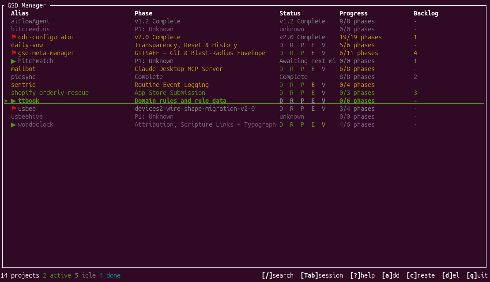
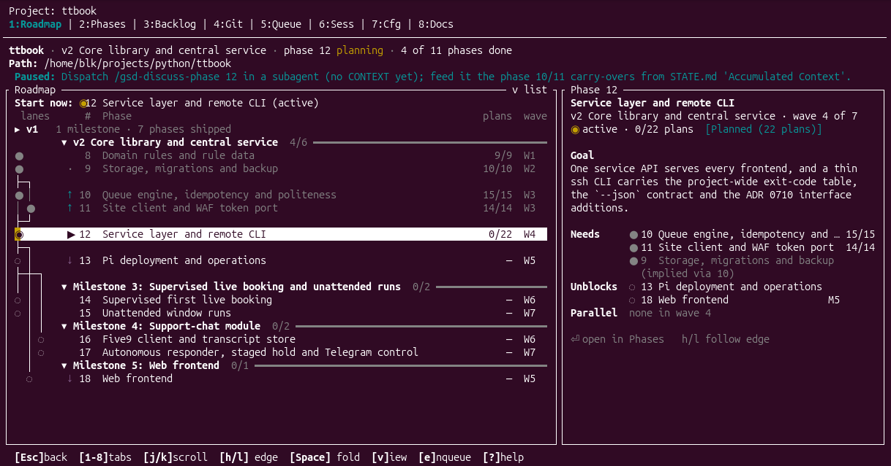

<!-- generated-by: gsd-doc-writer -->
# GSD Meta Manager

A TUI command center for managing multiple GSD-run projects from a single interface.
GSD stands for **Git. Ship. Done.**

## What is it?

GSD Meta Manager gives you a unified dashboard across all your GSD workflow
projects. It reads `.planning/` state directly from disk -- no
need to launch Claude or run `/gsd-progress` in each project directory. Register
your projects once and see phase status, roadmap progress, queued work, and
pending actions at a glance.

**GSD compatibility:** regularly synced against gsd-core releases. At startup
the app reads which gsd-core you have installed and warns when it is newer than
what this build is synced to -- see [Compatibility](#compatibility) and
[docs/GSD-CORE-SYNC.md](docs/GSD-CORE-SYNC.md) for the exact baseline. This
build is synced to gsd-core 1.20.1 (`v1.20.1`), with oracle pin `1.20.1`.





## Why GSD Meta Manager?

GSD Meta Manager is the **cross-project** command center: it observes and acts on
*every* registered project at once, from a single terminal. What you get spanning
all of them:

- **Zero-token state reading** -- parses each project's `.planning/` directory on
  disk. No Claude run, no `/gsd-progress`, no API cost required to see status.
- **Claude session awareness** -- detects which projects have a live `claude`
  instance, launches or resumes a session on any of them (in a new tmux window
  or herdr tab when the TUI runs inside one, else in a GUI terminal), and
  auto-registers new projects from active sessions (Linux only -- see
  [Platform support](#platform-support)).
- **Initial Codex support** -- interactive `codex` sessions are detected and
  shown alongside Claude sessions (reachable with `Tab` under tmux or herdr). Resume stays
  Claude-only -- see [Platform support](#platform-support). Next-command
  suggestions also use a Codex-only GSD install (`~/.codex/gsd-core`, or
  `$CODEX_HOME/gsd-core`; a Claude install under `$CLAUDE_CONFIG_DIR/gsd-core`
  is found too). The app does not drive Codex: the experimental driver launcher
  runs Claude only.
- **tmux and herdr focus** -- `Tab`-to-switch straight into a project's running
  Claude session, in its tmux pane or its herdr pane, without hunting through
  terminal tabs. When tmux and herdr are nested, the innermost one is used.
- **Milestone archive browsing** -- read shipped-milestone artifacts with inline
  markdown rendering in a project's Docs › Milestones sub-tab (`←` `→` inside
  the Docs tab switch Files / Milestones), without leaving the dashboard.

### Where it fits in the GSD ecosystem

GSD Meta Manager sits beside GSD rather than inside it: it reads what GSD
leaves on disk and writes only the few files listed below.

| GSD piece | Relationship |
|-----------|--------------|
| gsd-core (`.planning/`) | What the app manages: each project's `.planning/` state, read straight from disk. Regularly synced to gsd-core releases -- see [Compatibility](#compatibility) |
| `/gsd-progress`, `/gsd-manager` | One project, from inside a Claude session. This app covers every registered project from outside any session |
| `claude-orchestration` backend | Runs one project's phase waves in parallel inside a single Claude session, leaving the same commits and `SUMMARY.md` files as normal execution -- complementary, and read like any other run |
| Runtimes | Claude Code and Codex: live sessions are detected (Linux). The experimental driver launcher runs Claude in a sandbox ([docs/DRIVER-SANDBOX.md](docs/DRIVER-SANDBOX.md)); Codex is detected, never driven. Resume is Claude-only |
| gsd-tools | Called read-only, as `gsd-tools smart-entry --json`, for next-command suggestions |
| Capabilities | Their `capabilities.*` config keys are on the Config tab; keys this build does not model round-trip losslessly as read-only rows. Installed packs are not read |
| gsd-pi | Not supported: it keeps project state in its own `.gsd/` directory and database, not `.planning/` |

What it writes:

- `.planning/config.json` and `$GSD_HOME/.gsd/defaults.json`, on a Config-tab
  save -- under GSD's own lock, replaced atomically.
- `.planning/meta-manager/QUEUE.md` (Queue tab), its own config and log, and a
  new project's directory with `git init` (`c`).
- The experimental driver launcher: run directories under
  `.planning/meta-manager/drivers/`, files in its data directory -- plus whatever
  the GSD commands it launches write.
- Experimental one-off tasks: one run directory per task under its data
  directory (`gsd-meta-manager/oneoff/`), holding a private clone the agent
  commits in ([docs/CONFIGURATION.md](docs/CONFIGURATION.md#one-off-tasks)). A
  run, or its conflict resolver, can be stopped, killed or paused (`task stop`,
  or `x` / `X` / `z` in the TUI), and a paused or stopped run resumed from its
  branch or from master (`task resume`, or `u`); a run's `run.json` records
  the stop and the resume links, and its merge diff is bounded and exportable. A run
  lands into the branch `HEAD` pointed at when it was dispatched (`task land merge
  --into <branch>` overrides), and once it has landed or been pushed its clone and
  bulky files are removed, leaving a small record. A run whose launcher died (a
  crash, a reboot) is recovered as `crashed` on the next TUI start, `task list` or
  `task run`, its work kept as `gsd-oneoff/<run-id>`; orphan run directories are
  recycled and finished records age out after 30 days or beyond the newest 50 (only
  when nothing unlanded is left in them). Nothing is deleted unless its commits are
  already in a branch of the project.

What it never touches:

- Session transcripts (a subagent's is checked only for its timestamp, never
  opened), the GSD install, or installed capabilities.
- `ROADMAP.md`, `STATE.md` or phase artifacts, except through your `$EDITOR`
  (`e`). Git is read with `--no-optional-locks`. The app never commits in your
  checkout; it pushes, or fast-forwards your checkout, only when you land an
  experimental driver or one-off run. A one-off run that cannot fast-forward is
  merged in a private clone first (a sandboxed agent session resolves conflicts),
  and your checkout only fast-forwards to that merge. When the branch a one-off
  run lands into is not the one you have checked out, the app moves that branch
  with `git update-ref` (expected old value) and never touches your working tree.

## Features

- Unified dashboard with color-coded project status (active, paused, idle).
  The dashboard's `k/n phases` and the Roadmap header's `k of n phases done`
  count the current milestone's phases; a phase is done once its
  implementation is finished (executed on disk, or ticked in ROADMAP.md when
  it has no phase directory). Verification state is shown separately.
- Live filesystem watching -- auto-refreshes when `.planning/` files change
- Vim-style navigation (`j`/`k`, `/` search, `Enter` to drill in)
- Mouse support: click tabs, sub-tabs and rows on every tab, double-click to
  open, click a Roadmap band's `▸` / `▾` to fold it, and scroll lists and panes
  with the wheel; `M` turns mouse capture off and on
- 8-tab detail view (plus the experimental Driver tab): Roadmap (phase list
  with git-log-style dependency lanes and a detail pane showing each phase's
  goal, needs, unblocks and parallel phases), Phases (the selected phase's
  ladder and stage summary above a focusable Waves pane: one row per plan
  with its state, PLAN.md title and act/est tokens, finished waves folded;
  the stage summary flags a non-passed or unparseable verification report
  with the command to run, and shows the code-review ledger's open/deferred
  counts),
  Backlog, Git History,
  Queue, Sessions (with an Agents sub-view), Config, Docs (Files: rendered
  `.planning/` browser rooted at
  the active phase, with quick jumps to `.planning/` and back; Milestones: the
  shipped-milestone archive)
- Queue management: create, edit, delete, and reorder items
- New project creation from within the TUI
- Session detection -- shows which projects have a live Claude instance
  (Codex best-effort, no resume); see [Platform support](#platform-support).
  Each Sessions row shows the session's tmux or herdr location, see
  [Terminal multiplexers](#terminal-multiplexers)
- Running agents -- for each project, which GSD agents are running right now,
  read from git worktrees and Claude Code's subagent metadata without invoking
  Claude: the dashboard Status cell summarises the live wave (e.g. `w2/11 13run`,
  or an estimated `~5/12 fixed` for code-review fix runs), and the Sessions tab's
  Agents sub-view (`→` inside the Sessions tab) shows a one-line wave strip
  above every agent with its plan, commits, dirty files and last activity;
  `Enter` on an agent jumps to its plan in the Phases tab's Waves pane, and
  `Enter` on a plan there jumps back to its agent
- Worktree-only plans -- plans that live only in a linked git worktree (main's
  phase directory is empty or absent) are browsable in the Phases tab's Waves
  pane, titled `plans in worktree <name> (<branch>)`, and counted on the
  Roadmap with an `@<ref>` badge. Main's plans always win; with several
  worktrees holding the phase, the one with the newest PLAN wins (` +N more`
  names the rest). Read-only, and refreshed on the ~5 s agents poll
- Auto-registration of GSD projects from active Claude sessions, with git
  linked worktrees resolved to their main worktree so many concurrent agent
  sessions yield a single entry (see [Quick start](#quick-start))
- Paused project detection (parses HANDOFF files). A handoff is ignored as
  stale when its phase is behind STATE.md's `current_phase`, or when STATE.md's
  `last_updated` is more than an hour newer than the handoff's `timestamp`
  (the file's mtime when it has none); the detail view then shows a dimmed
  "Stale HANDOFF ignored" hint, with no pause badge or needs-human flag
- Search and filter across projects
- GSD version awareness -- each project's effective gsd-core install and its
  version are compared with the version this build is synced to; see
  [Compatibility](#compatibility)

## Installation

Requires **Rust 1.89+**.

### From crates.io

```bash
cargo install gsd-meta-manager
```

### From source

```bash
cargo install --path .
```

### Build manually

```bash
cargo build --release
```

The binary is at `target/release/gsd-meta-manager`.

## Quick start

1. Install the binary:

   ```bash
   cargo install gsd-meta-manager
   ```

2. Launch the TUI:

   ```bash
   gsd-meta-manager
   ```

3. Register a project in the TUI (press `a`, type an alias for the project and
   press `Enter`, then enter the path to any directory that contains a
   `.planning/` folder), or via the CLI:

   ```bash
   gsd-meta-manager add /path/to/your/gsd-project
   ```

4. Active `claude` sessions whose working directory contains `.planning/` are
   auto-registered on launch and during the ~5s session poll. A git linked
   worktree (such as an agent worktree under `.claude/worktrees/`) is never
   registered itself: a session inside one resolves to its main worktree, which
   is registered instead when it has `.planning/`, so many concurrent agent
   sessions of one project yield a single entry. `add` refuses a linked
   worktree and names the main worktree to register instead, and stale
   worktree entries are pruned from the config on launch.

## Usage

```text
$ gsd-meta-manager --help
TUI command center for managing multiple GSD-run projects from a single interface.

Usage: gsd-meta-manager [OPTIONS] [TARGET] [COMMAND]

Commands:
  add     Add a GSD project to the registry
  remove  Remove a project from the registry
  list    List all registered projects
  help    Print this message or the help of the given subcommand(s)

Arguments:
  [TARGET]
          Alias or path of a registered project to open directly

          An alias that shares its name with a subcommand (e.g. `list`) must be opened by its path instead, such as `gsd-meta-manager ./list` or the absolute path.

Options:
      --config <CONFIG>
          Path to config file (overrides default location)

  -h, --help
          Print help (see a summary with '-h')

  -V, --version
          Print version
```

### Key bindings

| Key              | Action                  |
|------------------|-------------------------|
| `j` / `↓`        | Move the selection down |
| `k` / `↑`        | Move the selection up   |
| `Enter`          | Open project detail     |
| `b`              | Open project detail on the Backlog tab |
| `/`              | Filter projects. Type to filter; `Enter` keeps the filter, `Esc` clears it. The help overlay (`?`) lists the filter syntax |
| `s`              | Toggle sort: alphabetical / attention first |
| `a`              | Add an existing project: type an alias, `Enter`, then its path, `Enter`; `Esc` cancels |
| `c`              | Create a new project: enter a name, then a path (`Tab` completes it), then confirm with `y` / `Enter` |
| `d`              | Remove the selected project from the registry after a `y` / `n` confirm; project files are not deleted |
| `Tab`            | Switch the terminal to the selected project's Claude / Codex session |
| `?`              | Show / hide the help overlay (`j` / `k` and `PgUp` / `PgDn` scroll it; `Esc` also closes it) |
| `M`              | Toggle mouse capture    |
| `q`              | Quit (dashboard); back to the dashboard (detail view) |
| `Ctrl+C`         | Force quit from any screen |

With `GSDMM_EXPERIMENTAL_FEATURES` set, `Shift+D` in the detail view opens the
experimental Driver tab; see [Configuration](docs/CONFIGURATION.md).

The detail view has two focus levels: the **tab bar** at the top and the
**content** of the active tab below it. It opens on the content of the tab you
last used; the active tab is shown bracketed, e.g. `[6:Sess]`, and while the tab
bar has focus it is also reversed and the content is dimmed.

| Key (detail view) | Action |
|-------------------|--------|
| `1`-`8`           | Jump straight into a tab's content |
| `←` `→`           | Tab bar: previous / next tab; stops at the first / last tab. Inside Sessions or Docs: previous / next sub-tab (Sessions / Agents, Files / Milestones), stopping at the ends. On the Phases tab, `→` focuses the Waves pane; with a Backlog item open, `←` closes it. Inside any other tab: switch tab and return to the tab bar |
| `↓` / `j` / `Enter` / `Space` | Tab bar: enter the tab's content (no action is taken) |
| `↑` / `k`         | From the first row of the content: back to the tab bar |
| `[` `]`           | Sessions / Docs: previous / next sub-tab (on the Roadmap list: previous / next phase in the same wave) |
| `Esc`             | Close an open pane or level first; otherwise go to the tab bar; at the tab bar, back to the dashboard |
| `q`               | Back to the dashboard from any level |
| `m`               | Sessions / Docs: switch sub-tab (alias of `←` `→`) |
| `Tab`             | Switch the terminal to this project's Claude / Codex session (on the Sessions tab, the highlighted session) |

`6` and `8` re-open the sub-tab you last used on the Sessions and Docs tabs.

Tab-specific keys:

| Tab | Key | Action |
|-----|-----|--------|
| Roadmap | `j` `k` `g` `G` `PgUp` `PgDn` | Move the phase cursor, jump to top / bottom, or page |
| Roadmap | `h` / `l` | Jump to a dependency / to a phase it unblocks; repeat to cycle |
| Roadmap | `[` / `]` | Previous / next phase in the same wave |
| Roadmap | `Space` | Fold / unfold the milestone |
| Roadmap | `Enter` | Open the phase in Phases. On a milestone row, fold / unfold it; on the shipped-milestones row, open Docs › Milestones |
| Phases | `→` / `Enter` / `Space` | Focus the Waves pane (on top of the right side, under the ladder) |
| Waves pane | `j` `k` `g` `G` `PgUp` `PgDn` | Move the row cursor, top / bottom, page |
| Waves pane | `Enter` / `Space` | Fold / unfold a wave (or a merged `w1–w10 ✓` row); on a plan, jump to its agent in Sessions › Agents |
| Waves pane | `e` | Edit the plan's PLAN.md in `$EDITOR` at its objective |
| Waves pane | `←` / `Esc` | Back to the phase list (`q` still leaves the detail view; a digit, `[` or `]` leaves the pane and acts as usual) |
| Backlog | `Enter` | Open / close the item's content pane |
| Backlog | `j` `k` `PgUp` `PgDn` | Scroll the open content pane |
| Backlog | `e` | With the pane open, edit the item where it lives (e.g. its ROADMAP.md section) in `$EDITOR`; otherwise enqueue it |
| Backlog | `←` / `Esc` | Close the content pane |
| Git | `Enter` | Show the selected commit's message and diff stat |
| Git | `p` | Toggle planning-only commits |
| Git | `PgUp` / `PgDn` | Scroll by a page |
| Git | `Esc` | Close the commit pane |
| Queue | `a` | Add an item |
| Queue | `e` | Edit the selected item. The item is removed while you edit, so `Esc` leaves it removed |
| Queue | `d` / `x` | Delete the selected item (asks first) |
| Queue | `Enter` / `Space` | Mark the selected item done, which removes it from the queue |
| Queue | `J` / `K` | Move the selected item down / up |
| Sessions | `Enter` | Resume the selected Claude session (Codex sessions cannot be resumed) |
| Sessions | `n` | Launch a new Claude session in this project |
| Sessions › Agents | `Enter` | Jump to the agent's plan in the Phases Waves pane (navigation only; nothing is sent to the agent) |
| Config | `Enter` | Edit the selected value; in an open dropdown, apply the choice. On a secret row (an API key, shown as `•••••••• (set)`) the prompt opens empty with hidden input, and an empty `Enter` keeps the current key — see [Secret values](docs/CONFIGURATION.md#secret-values-in-gsd-project-config-config-tab) |
| Config | `x` | Clear (unset) the selected value |
| Config | `g` (or `d`) | Switch between the project's config and `$GSD_HOME/.gsd/defaults.json` (`GSD_HOME` defaults to your home directory) |
| Config | `r` | Reload the config from disk |
| Config | `/` | Filter the rows; `Esc` clears the filter |
| Docs › Files | `Enter` | Open the selected directory or file |
| Docs › Files | `Esc` | Close the file, then go up one directory |
| Docs › Files | `g` / `p` | Jump to the `.planning/` root / back to the active phase's directory |
| Docs › Files | `e` | Open the selected file in `$EDITOR` |
| Docs › Milestones | `Enter` | Open the milestone, phase or file |
| Docs › Milestones | `Esc` | Back up one level |
| Docs › Milestones | `e` | Archived files are read-only, so this only shows a status message; a workstream's active-milestone docs (`ws …` rows) open in `$EDITOR` |
| Any other tab | `e` | Enqueue the suggested next GSD command |

#### Mouse

Mouse capture is on by default, on the dashboard and in the detail view. Dialogs,
the help overlay and text entry (the `/` search, Config value edits and the
Config filter) ignore the mouse.

| Mouse | Action |
|-------|--------|
| Click | Select a dashboard row; in the detail view, switch tab or sub-tab (exactly like its digit key, including Docs › Files / Milestones), or select a row on any tab — Roadmap, Phases, Backlog, Git, Queue, Sessions, Agents, Config (key or value column), Docs Files and Milestones, the Waves pane, the Driver runs — and focus that pane |
| Click `▸` / `▾` | Roadmap: fold or unfold that milestone band, or the shipped-milestones row |
| Click a Config value | On the row that is already selected, the same as `Enter`: opens the chooser or the editor (a secret's prompt opens empty) or steps an integer |
| Config chooser | Click an option to highlight it, click it again to apply; a click outside the chooser closes it without applying |
| Double-click | Open the row, the same as `Enter`: a project's detail view, a phase from the Roadmap, a Docs folder or file, a milestone level, a Backlog item's content, a Git commit, a Config chooser or editor, session resume, the Agents <-> Waves-pane jumps, wave fold / unfold. On a Roadmap band or the shipped row it folds / unfolds instead |
| Wheel | Over a list, move its selection one row per step; over the Backlog content, the Git commit or the Driver output, scroll it one line per step; over an open Docs file, scroll it. It never switches tabs or climbs to the tab bar |
| `M` | Toggle mouse capture on / off (not saved) |
| Shift+drag | Select and copy text while mouse capture is on (terminal-dependent) |

Not mouse-driven, on purpose: a Queue double-click does nothing, because
`Enter` there marks the action done and saves the queue (select with a click,
then press `Enter`); the Config `d` scope switch, breadcrumbs, the Git mode
line, footers and titles are labels, not controls; the phase names in the
Roadmap detail pane's Needs / Unblocks / Parallel lines are not links (`h` /
`l` follow them); the wheel over the Backlog list while its content pane is
open does nothing; dialogs, the help overlay and text entry ignore the mouse;
drag, right / middle click, hover and horizontal scroll are ignored.

To start with mouse capture off, set `"mouse": false` under `preferences` in
`config.json` (see [Configuration](docs/CONFIGURATION.md)).

### Examples

Open a project directly, by alias, from inside it (any subdirectory works too),
or by path:

```bash
gsd-meta-manager my-app
gsd-meta-manager .
gsd-meta-manager ~/projects/my-app
```

The TUI starts on that project's detail view; Esc returns to the overview with
that project selected. A target that is neither a registered alias nor inside a
registered project exits with a hint to run `gsd-meta-manager add <path>`. An
alias that collides with a subcommand name (e.g. a project registered as `list`)
must be opened by its path, such as `gsd-meta-manager ./list`.

Register a project with a custom alias:

```bash
gsd-meta-manager add /home/me/projects/my-app my-app
```

List all registered projects:

```bash
gsd-meta-manager list
```

Remove a project from the registry:

```bash
gsd-meta-manager remove my-app
```

### Scripting and agents

`gsd-meta-manager status --json [project...]` prints the state of every registered
project, or only the named aliases or paths, as ONE JSON document on one line.
It is read-only: it takes no lock, writes no log file or journal and does not
touch the registry, so it is safe to run while GSD sessions are active. `--json`
is required. A named project is a registered alias, a path inside a registered
project, or a directory containing `.planning/`.

```bash
gsd-meta-manager status --json                 # every registered project, as `list` orders them
gsd-meta-manager status --json my-app ~/p/api  # just these two, in this order
```

Exit codes: `0` the document was printed, including entries that carry an
`error` (an unknown alias, a registered folder that is gone, a folder without
`.planning/`); `1` the registry could not be loaded or parsed (nothing on stdout,
one `status: ...` line on stderr); `2` a usage error, such as a missing `--json`.

Schema version 1:

```json
{
  "schema": "gsd-meta-manager/status",
  "schema_version": 1,
  "sessions_supported": true,
  "projects": [
    {
      "target": null,
      "alias": "my-app",
      "path": "/home/me/projects/my-app",
      "error": null,
      "milestone": {"version": "v1.2", "name": "Search", "status": "in_progress"},
      "phase": {"id": "4", "name": "Index builder", "status": "executed", "verification": "human_needed", "uat": "missing"},
      "progress": {"phases_done": 3, "phases_total": 6},
      "attention": [{"kind": "verification_human_needed", "phase": "4", "workstream": null, "status": null}],
      "sessions": [{"agent": "claude", "pid": 4242, "session_id": "0f3c9a", "cwd": "/home/me/projects/my-app", "tty": "pts/3"}],
      "next": {"advisory": true, "source": "phase-20-router", "project": "/home/me/projects/my-app", "target_phase": "4", "decision": "park", "command": null, "reason": "gate_verification_human_needed", "detail": "human_needed"},
      "warnings": []
    },
    {
      "target": "gone-app",
      "alias": null,
      "path": null,
      "error": {"kind": "unresolved", "message": "gone-app is neither a directory containing .planning/ nor a registered project"},
      "milestone": null,
      "phase": null,
      "progress": null,
      "attention": [],
      "sessions": [],
      "next": null,
      "warnings": []
    }
  ]
}
```

| Path | Type | Meaning |
|---|---|---|
| `schema` | string | always `gsd-meta-manager/status` |
| `schema_version` | integer | `1`. Bumped on any rename, removal or type change; new keys may be added without a bump |
| `sessions_supported` | bool | `true` on Linux. When false, `sessions` is always empty |
| `projects` | array | registry order (as `list`) with no names, else the order named |
| `projects[].target` | string or null | the name you passed (escaped); null when listing the registry |
| `projects[].alias` | string or null | registry alias (escaped); null for an unregistered path or an unresolved name |
| `projects[].path` | string or null | canonical project root, equal to `next.project`; null when unresolved |
| `projects[].error` | object or null | null on success |
| `projects[].error.kind` | string | `unresolved` / `folder_missing` / `no_planning` |
| `projects[].error.message` | string | one sentence, with names escaped |
| `projects[].milestone` | object or null | null only on error |
| `projects[].milestone.version` | string or null | STATE.md `milestone` |
| `projects[].milestone.name` | string or null | STATE.md `milestone_name` |
| `projects[].milestone.status` | string or null | STATE.md `status` |
| `projects[].phase` | object or null | the active phase; null on error or when no source names one |
| `projects[].phase.id` | string | the active phase number |
| `projects[].phase.name` | string or null | roadmap phase name, else STATE.md `current_phase_name` |
| `projects[].phase.status` | string or null | disk status of the phase (`discussed`, `planned`, `executed`, `complete`, ...) |
| `projects[].phase.verification` | string or null | VERIFICATION.md status (`passed`, `gaps_found`, `human_needed`, `missing`, ...) |
| `projects[].phase.uat` | string or null | UAT.md status (`pending`, `partial`, `missing`, ...) |
| `projects[].progress` | object or null | null only on error |
| `projects[].progress.phases_done` | integer | phases done in the current milestone |
| `projects[].progress.phases_total` | integer | phases in the current milestone |
| `projects[].attention` | array | pending human/UAT items, root first, then each workstream; empty on error |
| `projects[].attention[].kind` | string | `paused`, `external_job_waiting`, `continue_here`, `verification_human_needed`, `uat_outstanding`, `continue_here_blocking`, `deferred_verification` |
| `projects[].attention[].phase` | string or null | phase id for per-phase kinds |
| `projects[].attention[].workstream` | string or null | workstream name, null for the project root |
| `projects[].attention[].status` | string or null | the UAT status for `uat_outstanding`, else null |
| `projects[].sessions` | array | live agent processes in this project; empty on error |
| `projects[].sessions[].agent` | string | `claude` / `codex` |
| `projects[].sessions[].pid` | integer | process id |
| `projects[].sessions[].session_id` | string or null | escaped |
| `projects[].sessions[].cwd` | string | the process's working directory |
| `projects[].sessions[].tty` | string or null | e.g. `pts/3` |
| `projects[].next` | object or null | exactly what `gsd-meta-manager next <path> --json` prints; null only on error |
| `projects[].next.advisory` | bool | always true |
| `projects[].next.source` | string | `phase-20-router` |
| `projects[].next.project` | string | the project root |
| `projects[].next.target_phase` | string or null | the phase routed |
| `projects[].next.decision` | string | `run` / `park` / `goal_met` / `no_rule` / `none` |
| `projects[].next.command` | string or null | the advisory `/gsd-*` command when `decision` is `run` |
| `projects[].next.reason` | string | router token |
| `projects[].next.detail` | string or null | router token |
| `projects[].warnings` | array of strings | `state_md_unreadable`, `state_md_recovered` |

A session belongs to the deepest project root that contains its working
directory, so `cd src && claude` still counts for the project. Text a project
authored (names, ids) is escaped for terminals and cut at 200 characters;
artifact prose (goals, descriptions, handoff notes) never appears.

Stability: a rename, removal or type change of any path above bumps
`schema_version`; new keys may appear without a bump, so consumers should ignore
keys they do not know.

Recipes:

```bash
# Projects that need a human right now.
gsd-meta-manager status --json | jq -r '.projects[] | select(.attention | length > 0) | "\(.alias): \([.attention[].kind] | join(", "))"'

# The advisory next command per project.
gsd-meta-manager status --json | jq -r '.projects[] | select(.next.decision == "run") | "\(.alias): \(.next.command)"'

# Projects with a live Claude or Codex session.
gsd-meta-manager status --json | jq -r '.projects[] | select(.sessions | length > 0) | .alias'
```

`gsd-meta-manager --skill` prints a short agent skill (markdown) that teaches a
model to use `list`, `status --json`, `next --json` and jq. Install it for
Claude Code with:

```bash
mkdir -p ~/.claude/skills/gsd-meta-manager
gsd-meta-manager --skill > ~/.claude/skills/gsd-meta-manager/SKILL.md
```

### Configuration

User configuration is stored at:

```text
~/.config/gsd-meta-manager/config.json
```

(The directory is the platform's user config directory, so on macOS it is
`~/Library/Application Support/gsd-meta-manager/config.json`.)

Override the config location with `--config <PATH>`.

## How it works

GSD Meta Manager reads each registered project's `.planning/` directory to infer
phase status, roadmap progress, queue state, and workflow position. A filesystem
watcher ([notify](https://crates.io/crates/notify)) triggers live updates
whenever planning files change on disk. A single async event loop
([tokio](https://crates.io/crates/tokio)) races terminal input, filesystem
events, and a render tick interval -- the UI never blocks on I/O.

The TUI is built with [ratatui](https://crates.io/crates/ratatui) and the
[crossterm](https://crates.io/crates/crossterm) backend for cross-platform
terminal support.

## Requirements

- **Rust 1.89+** (for building from source)
- Produces a single static binary with no runtime dependencies

### Platform support

Live session detection, for both Claude and Codex, reads the Linux `/proc`
filesystem, so it works on Linux only. On macOS no running sessions are
detected: the Sessions tab stays empty, and auto-registration from running
sessions, tmux or herdr `Tab`-to-switch, and resuming a detected session have nothing to
act on. The rest of the TUI -- everything read from `.planning/` -- works
normally.

Windows builds (CI checks that it compiles) but is not exercised at runtime.
Saving config from the Defaults tab is refused there, and the driver launcher is
unavailable.

The experimental driver's sandbox is Linux-only (`bwrap` under a systemd user
scope); where it is unavailable a launch can run unsandboxed after a second
confirm, and the TUI lists which protections that run lacks. What the sandbox
does, what each missing protection means and which risks stay open are in
[docs/DRIVER-SANDBOX.md](docs/DRIVER-SANDBOX.md).

Codex session detection is best-effort: it relies on Codex CLI process details
that may change between releases. Interactive `codex` sessions are shown
alongside Claude sessions and can be reached with `Tab` under tmux or herdr;
non-interactive runs such as `codex exec` are not shown. Codex sessions cannot
be resumed from the TUI -- resume is Claude-only.

### Terminal multiplexers

tmux and herdr are supported today.

`Tab` on a session focuses it in the multiplexer it actually runs in. That is
decided from the session's own environment and process ancestry, not from where
the TUI runs, so a TUI in one multiplexer can focus a session in the other.
With nested multiplexers the innermost wins, and a herdr session shown through
a herdr client in a tmux pane is focused in herdr, then that tmux pane is
selected. New and resumed sessions open as a new tmux window or herdr tab when
the TUI runs inside one, and in a GUI terminal otherwise.

The Sessions tab ends every row with the session's location, for example
`tmux 0:1.2` or `herdr w2:p1 (via tmux 0:0.0)`. A trailing `?` on a herdr pane
means it was matched by working directory only, `—` means no multiplexer
finds the session, and `⋯` shows until the session poll (about 5 s) has
resolved it. Like session detection itself, this is Linux-only.

The `MultiplexerBackend` trait in `src/multiplexer/mod.rs` was designed with
zellij, WezTerm, kitty, GNU screen, Rex and herdr-core in mind. The design table
in that module's docs records how each would detect, focus and open. Support
for them is possible but not implemented.

Pull requests adding a backend are welcome if they are well tested. That means
fixture-script tests in the style of the tmux and herdr ones (no real
multiplexer needed), exact-match focus that refuses to guess, and launches only
through `ExecArgv` (no shell). See [Contributing](#contributing).

### Compatibility

Reads the `.planning/` state formats of the gsd-core release this build is
synced to (the baseline is recorded in
[docs/GSD-CORE-SYNC.md](docs/GSD-CORE-SYNC.md)). Because it
observes on-disk state rather than driving GSD, it is non-intrusive and works
alongside any GSD workflow backend, including the experimental
`claude-orchestration` execution path.

**Which GSD you have installed.** For every project the app finds the gsd-core
install GSD itself would load, in the same order as GSD's own resolver: a
project-local `.claude/gsd-core` or `.codex/gsd-core` overrides the global
`${CLAUDE_CONFIG_DIR:-~/.claude}/gsd-core` or `${CODEX_HOME:-~/.codex}/gsd-core`
install, and Claude beats Codex at the same scope. Its `VERSION` is compared
with the synced baseline:

- newer than the release this build is synced to -- a warning, because formats
  that release added may not be recognised;
- within the supported range up to the synced release -- in sync, no note;
- older than that range -- an informational note;
- no `VERSION` anywhere, or one that does not parse -- a note (an unparseable
  file's content is never displayed).

The result appears on each project's Config tab (right-aligned on its top
border), on the dashboard's border only when some project's install is newer,
and in one status line at startup. Detection reads `VERSION` files only and
never runs GSD, `node` or `gsd-tools`; an upgrade is picked up at the project's
next refresh.

## Contributing

Contributions welcome. Please open an issue to discuss changes before submitting
a PR.

## License

MIT License -- see [LICENSE](LICENSE) for details.
