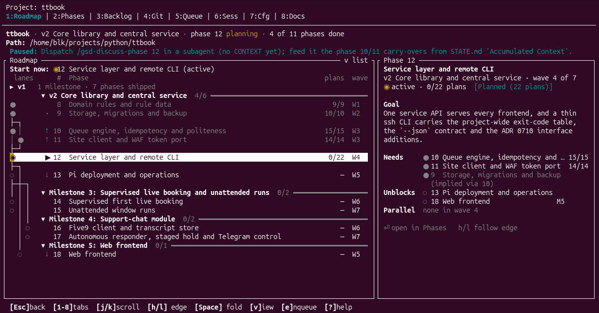

<!-- generated-by: gsd-doc-writer -->
# GSD Meta Manager

A TUI command center for managing multiple GSD-run projects from a single interface.
GSD stands for **Git. Ship. Done.**

## What is it?

GSD Meta Manager gives you a unified dashboard across all your GSD workflow
projects. It reads `.planning/` state directly from disk -- no
need to launch Claude or run `/gsd-progress` in each project directory. Register
your projects once and see phase status, roadmap progress, queued work, and
pending actions at a glance.

**GSD compatibility:** regularly synced against gsd-core releases. At startup
the app reads which gsd-core you have installed and warns when it is newer than
what this build is synced to -- see [Compatibility](#compatibility) and
[docs/GSD-CORE-SYNC.md](docs/GSD-CORE-SYNC.md) for the exact baseline. This
build is synced to gsd-core 1.23.0 (`v1.23.0`), with oracle pin `1.23.0`.




## Why GSD Meta Manager?

`/gsd-progress` and `/gsd-manager` show one project from inside a Claude session.
GSD Meta Manager covers **every** registered project from outside any session:

- **Zero-token state reading** -- parses each project's `.planning/` on disk. No
  Claude run, no API cost to see status.
- **What waits on you** -- the [owner inbox](docs/OWNER-INBOX.md) collects the
  checks only you can run, the rulings you have to make and the code that needs an
  agent, across all projects, and tells you which ones close a phase.
- **Session awareness** -- shows which projects have a live Claude or Codex
  session, switches your terminal to it (tmux or herdr), and launches or resumes
  Claude sessions (Linux; see [Platform support](#platform-support)).
- **Running agents** -- which GSD agents are working right now, per wave and plan,
  read from git worktrees and Claude Code's subagent metadata.
- **Scriptable** -- `status`, `next` and `inbox` print the same data as JSON for
  scripts and agents ([docs/SCRIPTING.md](docs/SCRIPTING.md)).

## Features

- Dashboard with color-coded status, progress, owner work and live sessions per project
- Live updates whenever `.planning/` files change
- Project detail view: Roadmap with dependency lanes, Phases with their waves and
  plans, Backlog, Git history, Queue, Sessions and running agents, Config, and a
  rendered `.planning/` and milestone-archive browser
- Queue management and new-project creation from inside the TUI
- Auto-registration of GSD projects from running Claude sessions
- Paused-project detection from GSD handoff files
- Search, filter and attention-first sorting across projects
- Keyboard-first, with mouse support; press `?` anywhere for the keys of that screen

## Installation

Requires **Rust 1.89+**.

```bash
cargo install gsd-meta-manager      # from crates.io
cargo install --path .              # from a checkout
```

## Quick start

```bash
gsd-meta-manager                              # launch the TUI
gsd-meta-manager add /path/to/your/gsd-project  # register a project (or press `a` in the TUI)
```

Projects with a running `claude` session are registered automatically. The rules
for what counts as a GSD project, and what is never auto-registered, are in
[docs/GETTING-STARTED.md](docs/GETTING-STARTED.md), which walks through the first run.

Press `?` in the TUI for every key binding.

## Usage

```bash
gsd-meta-manager my-app            # open a project's detail view by alias
gsd-meta-manager .                 # ... or the project you are in
gsd-meta-manager list              # registered projects
gsd-meta-manager remove my-app     # unregister (files are untouched)
gsd-meta-manager inbox             # what waits on you, as a short digest
gsd-meta-manager status --json     # every project's state for scripts
gsd-meta-manager --help            # all subcommands
```

An unregistered folder that is a GSD project is registered under its folder name
when you open it. `--config <PATH>` overrides the config location.

Agents can learn the CLI from a bundled skill:

```bash
mkdir -p ~/.claude/skills/gsd-meta-manager
gsd-meta-manager --skill > ~/.claude/skills/gsd-meta-manager/SKILL.md
```

## Where it fits in the GSD ecosystem

GSD Meta Manager sits beside GSD rather than inside it: it reads what GSD
leaves on disk and changes GSD files only through GSD's own commands.

| GSD piece | Relationship |
|-----------|--------------|
| gsd-core (`.planning/`) | What the app manages: each project's `.planning/` state, read straight from disk |
| `/gsd-progress`, `/gsd-manager` | One project, from inside a Claude session. This app covers every registered project from outside any session |
| `claude-orchestration` backend | Runs one project's phase waves in parallel inside a single Claude session; complementary, and read like any other run |
| Runtimes | Claude Code and Codex sessions are detected (Linux). The experimental driver launcher runs Claude in a sandbox ([docs/DRIVER-SANDBOX.md](docs/DRIVER-SANDBOX.md)); Codex is detected, never driven |
| gsd-tools | Your own gsd-core install, never one a project ships: next-command suggestions, owner-inbox acknowledgements, and Config-tab project saves |
| gsd-pi | Not supported: it keeps project state in its own `.gsd/` directory and database, not `.planning/` |

**What it writes:** `.planning/config.json` only through your gsd-tools
`config-set`; `$GSD_HOME/.gsd/defaults.json` under GSD's installer lock (gsd-core has
no command for it); its own queue (`.planning/meta-manager/QUEUE.md`), config and
log; and, for the experimental driver and one-off tasks, their run directories
([docs/CONFIGURATION.md](docs/CONFIGURATION.md#one-off-tasks)).

**What it never touches:** session transcripts, the GSD install, or `ROADMAP.md`,
`STATE.md` and phase artifacts (except through your `$EDITOR`). It never commits in
your checkout; it pushes or fast-forwards only when you land an experimental driver
or one-off run.

## Configuration

User configuration lives in the platform's config directory:
`~/.config/gsd-meta-manager/config.json` on Linux,
`~/Library/Application Support/gsd-meta-manager/config.json` on macOS. A running TUI
writes back only its own registry changes, so `add` and `remove` from the command
line are never undone. The format, preferences and environment variables are in
[docs/CONFIGURATION.md](docs/CONFIGURATION.md).

## Platform support

- **Linux:** everything.
- **macOS:** everything read from `.planning/` works. Live session detection reads
  `/proc`, so no running sessions are found, and features built on them (Sessions
  tab, auto-registration, switching to a session) have nothing to act on.
- **Windows:** builds (checked in CI) but is not exercised at runtime; saving
  defaults and the driver launcher are unavailable.

Codex detection is best-effort and resume is Claude-only. The experimental driver's
sandbox is Linux-only (`bwrap` under a systemd user scope); see
[docs/DRIVER-SANDBOX.md](docs/DRIVER-SANDBOX.md).

Terminal multiplexers: tmux and herdr. A session is focused in the multiplexer it
actually runs in, and new sessions open as a tmux window or herdr tab when the TUI
runs inside one, else in a GUI terminal. Backends for others (zellij, WezTerm,
kitty, ...) are designed for in `src/multiplexer/mod.rs` but not implemented.

## Compatibility

Reads the `.planning/` formats of the gsd-core release this build is synced to
([docs/GSD-CORE-SYNC.md](docs/GSD-CORE-SYNC.md)). Because it observes on-disk state
rather than driving GSD, it works alongside any GSD workflow backend.

For every project the app finds the gsd-core install GSD itself would load (a
project-local `.claude/gsd-core` or `.codex/gsd-core` first, then
`${CLAUDE_CONFIG_DIR:-~/.claude}/gsd-core` or `${CODEX_HOME:-~/.codex}/gsd-core`) and
compares its `VERSION` with the synced baseline. A newer install gets a warning,
because formats it added may not be recognized; an older one gets a note. The
result shows on the project's Config tab, on the dashboard border when some install
is newer, and at startup. Detection reads `VERSION` files only and never runs GSD.

## How it works

Each registered project's `.planning/` directory is parsed to infer phase status,
roadmap progress, queue state and workflow position. A filesystem watcher
([notify](https://crates.io/crates/notify)) triggers live updates, and a single
async event loop ([tokio](https://crates.io/crates/tokio)) races terminal input,
filesystem events and a render tick, so the UI never blocks on I/O. The TUI is
built with [ratatui](https://crates.io/crates/ratatui) and
[crossterm](https://crates.io/crates/crossterm). Architecture details are in
[docs/ARCHITECTURE.md](docs/ARCHITECTURE.md).

## Contributing

Contributions welcome. Please open an issue to discuss changes before submitting a
PR; see [CONTRIBUTING.md](CONTRIBUTING.md), and [docs/DEVELOPMENT.md](docs/DEVELOPMENT.md) for building and testing. A new
multiplexer backend is welcome if it comes with fixture-script tests like the tmux
and herdr ones, exact-match focus that refuses to guess, and launches only through
`ExecArgv` (no shell).

## License

MIT License -- see [LICENSE](LICENSE) for details.
