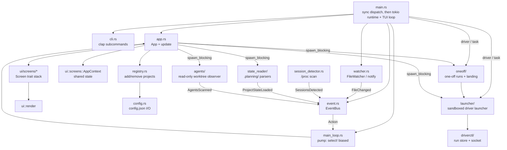

<!-- generated-by: gsd-doc-writer -->
# Architecture

## System Overview

`gsd-meta-manager` is a single-binary Rust TUI that aggregates the state of multiple GSD-run
projects into one dashboard. It reads each project's `.planning/` directory from disk (the
dashboard itself never invokes Claude or any GSD command), watches those directories for
filesystem changes via `notify`, and renders an interactive ratatui interface backed by
crossterm. The architecture is an asynchronous, message-driven event loop: terminal input,
filesystem events, periodic ticks, and background I/O completions all funnel into a single
`tokio::sync::mpsc::UnboundedReceiver<Action>` that drives state mutation and re-render decisions.

The same binary also carries a set of synchronous, non-TUI entry points that start and control
sandboxed headless agent sessions: `driver` (a long-running sandboxed driver for a project),
`task` (a one-off `/gsd-quick` or `/gsd-fast` session in a private clone, with merge / push /
discard landing, stop / kill / pause, and resume), and the in-sandbox helpers `driverctl` and
`taskctl`. The TUI reaches them through the Driver tab and its one-off popups; they are described
under [Sandboxed Agent Runs](#sandboxed-agent-runs).

## Component Diagram



## Data Flow

A typical update cycle proceeds as follows:

1. **Source emits an event.** One of three producers pushes an `Action` onto the channel
   created in `event.rs`:
   - `EventBus::spawn_crossterm_reader` reads `crossterm::event::EventStream` and maps
     key / mouse / resize events into `Action::RawKey` / `Action::Mouse` / `Action::Resize`.
   - `EventBus::spawn_tick` fires `Action::Tick` every 250ms (`spawn_tick(250)` in `main.rs`).
   - `FileWatcher` (in `watcher.rs`) uses `notify_debouncer_full` with a 200ms debounce window;
     each batch is reduced to unique project roots via `extract_project_root`, then sent as
     `Action::FileChanged { project_path }`.
2. **Main loop receives the action.** `run_tui_loop` in `main.rs` calls `main_loop::pump`,
   whose `tokio::select!` is `biased;`: arm 1 awaits `rx.recv()` and calls `app.update(action)`
   (input is never queued behind other traffic), arm 2 is a 16ms redraw timer
   (`REDRAW_INTERVAL`) so the loop can progress when no message arrives.
3. **State is mutated.** `App::update` matches the action variant and either mutates `AppContext`
   directly (e.g. setting `status_message`) or schedules background work. For `FileChanged`, it
   debounces per-alias (500ms minimum between refreshes) and dispatches a `tokio::task::spawn_blocking`
   that calls `state_reader::parse_project_state` and sends back an `Action::ProjectStateLoaded`.
4. **Background completion re-enters the loop.** When the blocking task finishes, its result is
   sent through the same channel as a new `Action`, which `App::update` then applies to
   `AppContext.project_states` and invokes `change_tracker::detect_changes` to surface
   user-facing change notifications. The running-agents observer rides the same shape on the
   tick: `Action::Tick` every 20 ticks → `spawn_blocking(agents::scan_projects_guarded)` →
   `Action::AgentsScanned` → `waves::derive` → `AppContext.agent_views`, which the dashboard
   Status cell and the detail view's Sessions › Agents sub-view read without computing anything.
   The Driver tab's launcher-run refresh and the one-off popups follow the same
   request-action → `spawn_blocking` → result-action pairing (for example
   `OneoffRunRequested` → `OneoffRunStarted`, `OneoffDiffRequested` → `OneoffDiffLoaded`).
5. **Render decision.** When state changes flip `app.needs_redraw = true`, the loop calls
   `terminal.draw(|frame| ui::render(frame, app))`. `ui::render` delegates to the top screen on
   `app.screen_stack` (a `Vec<Box<dyn Screen>>`), which calls into ratatui widgets.
6. **Editor suspension (optional).** If a screen requested `ScreenAction::SuspendAndEdit`, the
   loop drops the terminal, spawns `$VISUAL` / `$EDITOR` / `vi` on the file via
   `std::process::Command`, then re-initializes ratatui.

## Key Abstractions

- **`Action` enum (`src/action.rs`)** — Tagged union of every event the app can react to. Groups:
  input and timing (`Tick`, `RawKey`, `Mouse`, `Resize`); project state (`FileChanged`,
  `ProjectStateLoaded`, `CreateProjectResult`, `GitLogLoaded`, `GitCommitDetailLoaded`,
  `SessionsDetected`, `ArchiveMilestonesDiscovered`, `ArchiveLoaded`, `AgentsScanned`);
  launcher and driver (`LauncherRunsRefreshed`, `LauncherRunRefreshed`, `LauncherMarker*`,
  `LauncherStopRequested` / `LauncherStopped`, `DriverSteer*`, `DriverEdit*`,
  `DriverLaunch*`, `DriverNewRun*`, `DriverLaunched`); and one-offs (`OneoffTodos*`,
  `OneoffRunRequested` / `OneoffRunStarted`, `OneoffCommandRequested`,
  `OneoffResumeRequested`, `OneoffCommandDone`, `OneoffViewerOpen`, `OneoffDiff*`,
  `OneoffDiffExport*`, `OneoffStreamBatch`, `OneoffInject*`, `OneoffStatusRefreshed`).
  All side effects flow through this enum.
- **`EventBus` (`src/event.rs`)** — Owns the `mpsc::UnboundedSender<Action>` and
  `mpsc::UnboundedReceiver<Action>`. Spawns the crossterm reader and tick task.
- **`main_loop::pump` (`src/main_loop.rs`)** — The testable core of the event loop, kept in the
  library (not the binary) so its priority ordering can be unit-tested without a terminal.
- **`App` (`src/app.rs`)** — Top-level state holder: `should_quit`, `needs_redraw`, `ctx`
  (`AppContext`), `screen_stack`, `active_sessions`, `session_poll_counter`, `pending_editor`.
  Its `update(action)` method is the sole entry point for state mutation.
- **`AppContext` (`src/ui/screens/mod.rs`)** — Shared mutable state passed to every screen:
  `config`, `project_states`, table selection, filter text, `view_cache`,
  `change_tracker`, `event_tx`, `watcher`, `active_sessions`, etc. Screens read and mutate
  this struct through `&mut AppContext` parameters.
- **`Screen` trait (`src/ui/screens/mod.rs`)** — `handle_key`, `render`, `name`, and
  `handle_mouse`. Implementations live in `src/ui/screens/` (`normal`, `detail`, `help`,
  `add_project`, `create_project`, `delete_confirm`, `enqueue`, `queue_delete_confirm`,
  `preferences`, `confirm_popup`, `driver*`, `oneoff`, `oneoff_viewer`). Screens return
  `ScreenAction` values (`None`, `Push`, `Replace`, `Pop`, `Quit`, `SetStatusMessage`,
  `SuspendAndEdit`, `DispatchAction`, `ToggleMouseCapture`) to signal navigation and side
  effects without owning the screen stack.
- **`ProjectState` (`src/state_reader/mod.rs`)** — Parsed snapshot of one project's
  `.planning/` directory: status, current phase, completion counts, milestone, phases,
  queued actions, per-phase disk inferences, pause state, etc. `ProjectState::phase_progress()`
  is the single phase-count definition (dashboard cell and Roadmap header), and
  `paused` / `stale_handoff` are decided once in the parser, so no consumer re-judges a HANDOFF.
- **`FileWatcher` (`src/watcher.rs`)** — Wraps a `notify_debouncer_full::Debouncer` with a
  200ms debounce. The callback extracts the project root (parent of `.planning/`) from each
  changed path and emits one `Action::FileChanged` per unique root.
- **`ChangeTracker` (`src/change_tracker.rs`)** — In-memory log of status transitions and
  phase completions since launch. Not persisted (per design decision D-07).
- **`ScreenAction::DispatchAction`** — Allows screens to enqueue arbitrary `Action`s back onto
  the bus. Used by long-running views (archive browser, git history, one-off popups) to request
  async data loads without blocking the render path.
- **`RunStore` (`src/driverctl/store.rs`)** — The single writer of a driver run's `state.json`,
  `LOG.md` and `DIRECTION.md` frontmatter; opening it requires holding the run lock.
- **`oneoff::store::RunRecord` (`src/oneoff/store.rs`)** — The host-written `run.json` of a
  one-off run, including the git refs (`base`, head, landing `range`) and the normalized
  `branch_state()` used by every display.
- **`AgentRuntime` (`src/oneoff/runtime.rs`)** — The one seam that names the agent; all other
  one-off modules are runtime-neutral (enforced by `tests/oneoff_runtime_seam_guard.rs`).

## State Management

State is **not** wrapped in `Arc<RwLock<...>>`. The app is single-threaded at the state layer:
`App` and `AppContext` live on the main task and are mutated exclusively by `App::update`. All
concurrency happens at the I/O boundary:

- **Producers** (crossterm reader, tick task, watcher callback, `spawn_blocking` workers) own
  cloned `mpsc::UnboundedSender<Action>` handles and never touch `AppContext`.
- **Consumer** is the single `run_tui_loop` task that owns the receiver and calls `update`.

This is the classic Elm/Redux-style funnel: the channel itself provides the synchronization,
so no locks are needed inside the state. Blocking file I/O (`state_reader::parse_project_state`,
git log queries, archive scans, one-off launches and landings) runs under
`tokio::task::spawn_blocking` and sends results back as `Action` variants — never mutating
shared state from worker threads. `tests/async_blocking_guard.rs` mechanically checks that the
synchronous launcher, `driverctl` and one-off code is not called from an `async fn`.

## Sandboxed Agent Runs

Everything below is synchronous (std threads, no tokio) and is dispatched from `main` before the
async runtime exists, except where the TUI calls it through `spawn_blocking`.

**Driver launcher (`src/launcher/`, `src/driverctl/`, `src/driver/`).** `driver launch` runs
one headless `claude -p` driver inside `bwrap` under `systemd-run --user --scope`. The launcher
process holds the per-run lock (`launcher.lock`, `flock`-based, no pid file), embeds the
`driverctl` `RunStore` and serves its unix socket from a thread, seeds a per-run
`CLAUDE_CONFIG_DIR`, resolves the OAuth token and builds the sandbox argv. `launcher::sandbox`
builds those command lines as pure functions; `launcher::egress` is the per-run egress server
(policy in `egress::policy`); `launcher::process` is the single spawn file; `launcher::push`
sends a finished run's branch tip to `refs/heads/gsd-auto/<alias>/<run-id>`; `launcher::stop`
implements `driver stop`. Inside the sandbox the driver reaches the store only through the
`driverctl` shim. `src/driver/` keeps the pure pieces: `direction` / `steer` (DIRECTION.md
parsing and atomic edits), `router` (picks the next GSD command with no model call; the contract
behind `next --json`), `rate_limit`, `liveness`, `kill` and `lock`. `src/envelope/` retains the
branch-namespace policy, the pull-request ledger and the credential-shape scan used by push.
See `docs/DRIVER-SANDBOX.md` for the sandbox's boundaries.

**One-off runs (`src/oneoff/`).** A one-off is one headless agent session running `/gsd-quick`
or `/gsd-fast` on a registered project in a private clone, with no driver. It composes the
launcher's pieces (sandbox argv, host probe, config seeding, egress, process seam) but never
calls `launcher::run::launch`.

- *Trust split.* The agent writes only its clone (`<run-dir>/work`) and
  `<run-dir>/report/report.json`. The host writes `run.json`, `stream.jsonl` and `launch.log`
  and re-validates the report with the same validator the `taskctl report` CLI uses
  (`report::read_validated`). Commit range, count and SUMMARY path are derived from git on the host.
- *Launch* (`launch.rs`): atomic run-dir claim, per-run `run.lock`, `--no-hardlinks` clone on
  branch `gsd-oneoff/<run-id>`, push mirror, sandbox, then a supervised wait loop. Any number of
  runs per project may be live. `session` and `inbox` implement the stdin session lifecycle and
  the host-only operator inbox (`task send`, the viewer's composer); `stream` is the
  runtime-neutral view of `stream.jsonl`.
- *Stop, kill, pause* (`cancel.rs`): a requester (`task stop`, TUI `x` / `X` / `z`) writes
  `<run-dir>/stop.request` (or `<run-dir>/land/stop.request` for a conflict resolver); only the
  run's own daemon or the landing process acts on it (TERM then KILL after a grace, immediate KILL,
  or a pause message and a longer grace). The files sit outside every sandbox bind. `cancel.rs`
  holds the request types, the graces and a pure `Cancel` state machine driven with injected instants.
- *Resume* (`resume.rs`): never reopens a run; it starts a new run id whose clone begins at the old
  head (`--from branch`) or at a host-made merge of the checkout's tip into it (`--from master`,
  with a sandboxed resolver on conflict). The new session is fresh and primed with the old task,
  report and commit log; the records link via `resumed_by` / `resumed_from`.
- *Landing* (`land.rs`, `resolve.rs`, `merge.rs`): merge, push or discard. A merge fast-forwards
  when possible; otherwise it is made in a private clone and conflicts go to one sandboxed resolver
  session, with the checkout changing only at the final fast-forward. `merge.rs` is the pure half
  (resolver budget, conflict-marker scan, merge subject, and `diff_view`, which builds the capped,
  per-file-summarized merge diff the TUI shows; `o` in that popup exports the full diff to a file).
  A per-run `land.lock` admits one landing at a time.
- *TUI surfaces:* `ui/screens/oneoff.rs` (todo picker, task entry, run list with e / m / p / D /
  x / z / u / d / v / r actions) and `oneoff_viewer.rs` (live stream viewer with a composer). Both
  read only the view cache and dispatch `Action`s; all file and git reads run in `App`.

## Directory Structure Rationale

```
src/
├── main.rs                  binary entry: sync dispatch of driver/task/next/driverctl/taskctl/envelope,
│                            then tokio runtime, TUI loop
├── lib.rs                   re-exports every non-binary module for tests
├── cli.rs                   clap definitions: add / remove / list / driver / task / next and internal
│                            envelope / driverctl / taskctl / bridge
├── driver_cli.rs, task_cli.rs, next_cli.rs, driverctl_cli.rs, taskctl_cli.rs
│                            command bodies behind the non-TUI subcommands (binary-side)
├── event.rs                 EventBus: crossterm reader + tick task + mpsc channel
├── main_loop.rs             pump(): the biased select! body of the TUI loop
├── tui.rs                   thin wrapper around ratatui::init / ratatui::restore
├── action.rs                Action enum (all message variants)
├── app.rs                   App struct, App::update dispatcher, DetailSubView, filter logic
├── config.rs                Config / RegisteredProject / Preferences serde types + I/O
├── registry.rs              add/remove project validation, auto-register from sessions
├── launch_target.rs         resolve the CLI's positional <alias|path> target
├── watcher.rs               FileWatcher around notify-debouncer-full
├── session_detector.rs      /proc scan for active `claude` processes
├── multiplexer/             focus and launch inside a terminal multiplexer, or a GUI terminal
│   ├── mod.rs               the MultiplexerBackend trait, detection and innermost ordering, the seam
│   ├── tmux.rs              tmux backend: focus by exact pane tty, new window
│   ├── herdr.rs             herdr backend: focus by session id / pid / cwd, new tab via the socket
│   └── gui.rs               GUI terminal fallback chain
├── project_creator.rs       Bootstrap a fresh GSD project (used by CreateProjectScreen)
├── change_tracker.rs        In-memory change log
├── archive.rs               Milestone archive parsing for the Archive sub-view
├── browser.rs               .planning/ docs browser (directory listing + file view)
├── bounded_output.rs        run a read-only command with a wall-clock budget (background scans)
├── text.rs                  terminal-safe rendering and sanitizing of untrusted text
├── experimental.rs          GSDMM_EXPERIMENTAL_FEATURES startup flag
├── error.rs                 typed error for the run-lock refusal
├── test_support.rs          shared fixture shape constants
├── agents/                  read-only agent-worktree scan, runtime adapters, wave model
├── state_reader/            All `.planning/` file parsers
│   ├── mod.rs               ProjectState struct + parse_project_state aggregator
│   ├── state_md.rs          Parse STATE.md YAML frontmatter
│   ├── roadmap_md.rs        Parse ROADMAP.md phase list
│   ├── queue_md.rs          Parse QUEUE.md queued actions
│   ├── backlog.rs           Enumerate 999*-prefixed backlog phase dirs
│   ├── disk_status.rs       Infer phase status from on-disk artifacts
│   ├── plan_waves.rs, phase_num.rs, workstreams.rs, driver_frontmatter.rs
│   ├── config_json.rs       Parse `.planning/config.json` (GSD project config)
│   ├── config_write.rs, config_secrets.rs, gsd_install.rs
│   └── git_ops.rs           Shell out to `git log` / `git diff --stat`
├── launcher/                sandboxed driver launcher: run, sandbox, egress/, auth, push, stop, ...
├── driverctl/               run store, socket server, LOG grammar, counters, stop guard
├── driver/                  DIRECTION/steer, router, rate_limit, liveness, kill, lock
├── driver_templates/        `driver new` templates and the DIRECTION lint
├── envelope/                push branch policy, PR ledger, credential-shape scan
├── journal/                 identity-path predicate, change classifier, digests, redactor, log tail
├── executor/                stream-json wire parser (test-only today)
├── oneoff/                  one-off runs: launch, session, inbox, stream, cancel, resume,
│                            land, resolve, merge, store, report, runtime, prompt, todos
└── ui/
    ├── mod.rs               ui::render entry point — delegates to top screen
    ├── roadmap_view.rs, roadmap_graph.rs   Roadmap tab widgets
    ├── glyphs.rs, mouse.rs  shared glyph set and mouse hit-testing
    └── screens/
        ├── mod.rs           Screen trait, ScreenAction, AppContext, ProjectViewCache
        ├── normal.rs        Project list (default screen)
        ├── detail.rs        Per-project detail with sub-views (RoadmapViz,
        │                    Pipeline (Phases), Backlog, GitHistory, Queue,
        │                    Sessions + Agents (Sessions: Sessions / Agents),
        │                    Defaults, Browse + Archive (Docs: Files / Milestones),
        │                    Driver)
        ├── driver*.rs       Driver tab: run list, launch, confirm, steer
        ├── oneoff.rs, oneoff_viewer.rs   one-off popup and live viewer
        ├── add_project.rs, create_project.rs, delete_confirm.rs, enqueue.rs,
        │   queue_delete_confirm.rs, confirm_popup.rs, preferences.rs
        ├── render_escape_guard.rs   tests that untrusted text is escaped on every screen
        └── help.rs          Key-binding help overlay
tests/                       Integration tests (assert_fs against synthetic .planning/ trees,
                             launcher / driverctl / one-off end-to-end, and source-walking guards)
```

The split between `state_reader/` (read-only `.planning/` parsing), `ui/screens/` (input +
render), and the top-level orchestration modules (`app.rs`, `event.rs`, `watcher.rs`)
keeps each layer independently testable. `lib.rs` exposes every module publicly so the
integration test suite under `tests/` can drive the same code paths the binary uses. Source-walking
guard tests (`async_blocking_guard`, `spawn_seam_guard`, `oneoff_runtime_seam_guard`,
`agents_scan`) enforce the architectural boundaries above mechanically.

## Concurrency Model

- **One async task per producer.** `tokio::spawn` is used for: the crossterm event stream
  reader, the 250ms tick interval, and ad-hoc `spawn_blocking` workers for filesystem
  reads, git commands, session detection, and one-off launches, landings and diff reads.
- **One async task for the loop.** `run_tui_loop` runs to completion on the main `#[tokio::main]`
  task. Each iteration calls `pump`, which handles at most one action (or a redraw tick), then
  performs at most one render.
- **No held locks across `.await`.** Because all shared state lives in `App` on the loop task
  and is never accessed off-task, the entire `tokio::sync::Mutex` vs `std::sync::Mutex`
  question is sidestepped.
- **The launcher side is synchronous.** `driver` and `task` subcommands, the launcher daemon, the
  one-off supervisor and `driverctl` use std threads and `flock`; they coordinate through lock
  files, the run store and host-only request files rather than shared memory.
- **Debouncing happens at two layers.** `notify_debouncer_full` collapses raw filesystem
  events within 200ms; `App::update` adds a second 500ms per-project guard via
  `AppContext.last_refresh` to prevent re-parse storms when multiple `.planning/` files
  change in rapid succession.

## Render Strategy

Rendering is **opt-in** rather than every-frame:

- `App.needs_redraw` and `AppContext.needs_redraw` default to `true` on startup.
- Screens set `ctx.needs_redraw = true` when their internal state changes; `App::update` sets
  `app.needs_redraw = true` after any state mutation that affects display.
- The loop reconciles `ctx.needs_redraw` into `app.needs_redraw` before each `pump`, draws
  if set, then clears the flag.
- The 250ms tick exists only to expire status messages and drive periodic polling (new Claude
  sessions, launcher markers and the agents scan, every 20 ticks ≈ 5s) — not to drive rendering.

This avoids burning CPU on a 60fps render loop when nothing has changed, which matters for
a long-running dashboard that may sit idle for hours between events.
